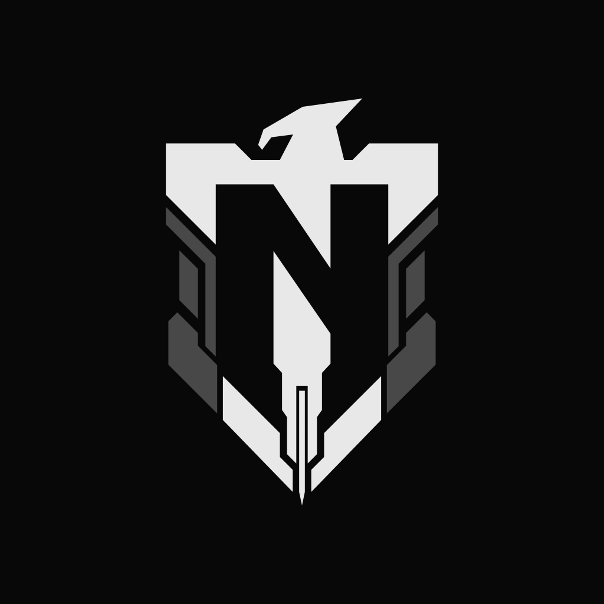
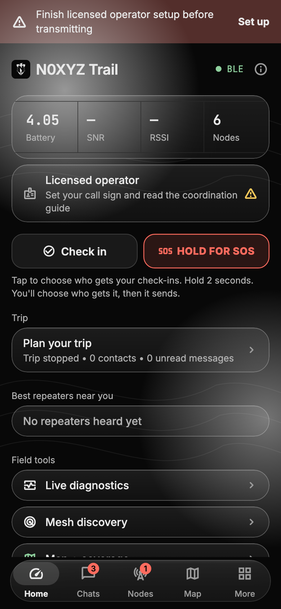
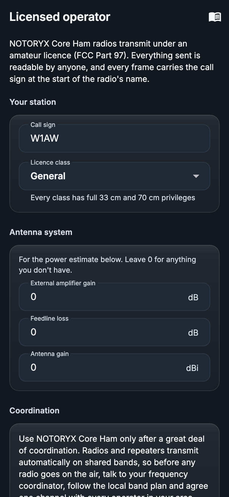
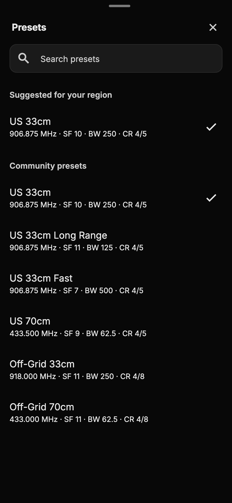
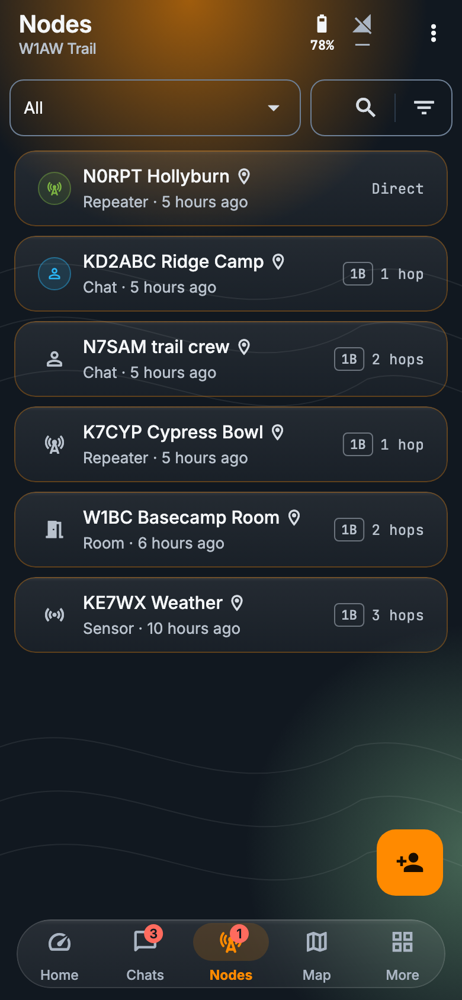
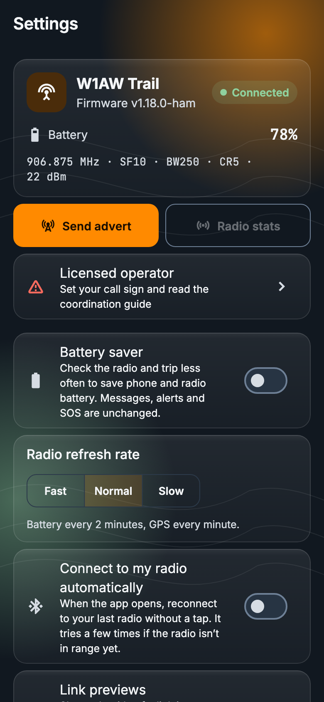
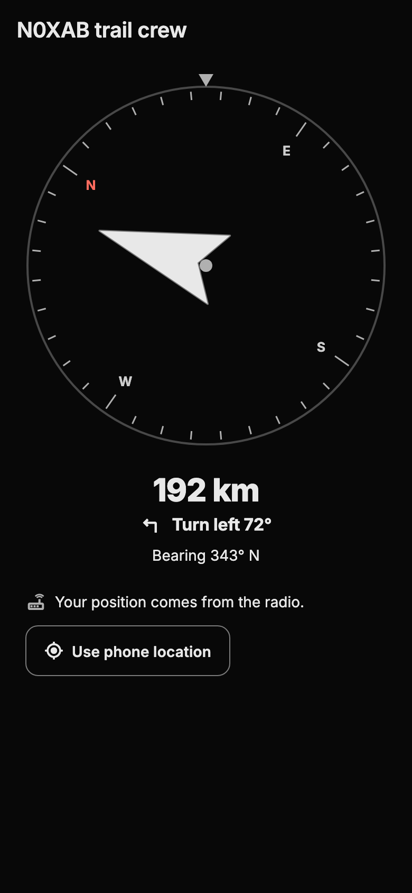
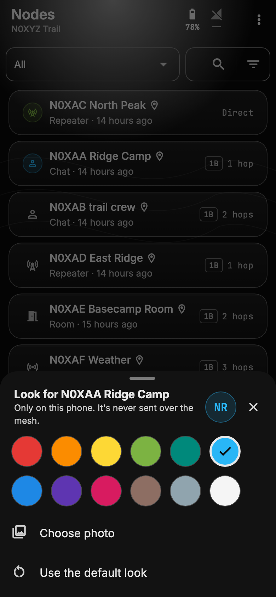
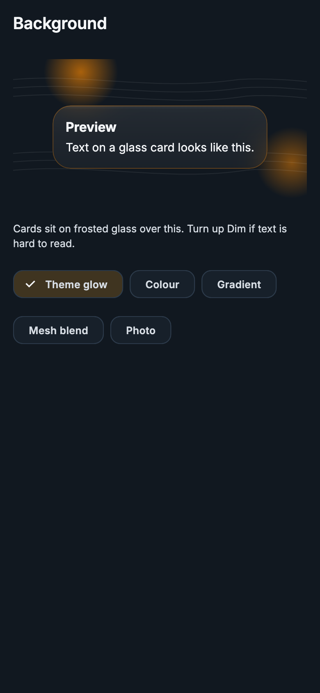

  

# NOTORYX Core Ham releases

Downloads for **NOTORYX Core Ham**: off-grid LoRa mesh messaging for licensed US amateur radio operators (FCC Part 97). It's the ham edition of NOTORYX Core and installs as its own app (`com.bastionmesh.ham`), next to NOTORYX Core.

> [!WARNING]
> **Use only after a great deal of coordination.** This software and its firmware transmit automatically on shared amateur bands, and every repeater relays under its operator's licence. Before any radio goes on the air, coordinate with your frequency coordinator, the local band plan and every operator in your area. Read the [coordination guide](COORDINATION.md) first.

  
  
  

## Status

**Test builds only.** The newest (Android and Mac) is always at the top of **[the releases page](../../releases)**. The app and the [NOTORYX Ham firmware](https://github.com/TheLogsAreScreaming/NOTORYX-Core-Ham-Firmware) pass automated tests and a mesh simulator, but haven't been tested on the air yet. Use them on a bench with dummy loads or minimum power, and read the warning in each release first.

## What it does

- **Your call sign on every frame**, including frames a repeater relays. A radio stays silent until its name starts with a valid US call sign.
- **Plain text, as Part 97 requires.** Authentication is kept; nothing is encrypted. Everything you send is readable by anyone.
- **33 cm and 70 cm only**, with US presets (906.875 MHz default).
- **Repeater logins without sending the password.**
- **Licensed operator setup** in the app: call sign, licence class and a coordination acknowledgment.
- Everything else from NOTORYX Core: check-ins, SOS, trip contacts, maps, path tools and field tools.
- **Recently added:**
  - The Fresnel zone on line of sight.
  - A compass that points to any node (**Point me to it**).
  - A photo or colour per node.
  - Your own background behind the glass cards.
  - Each nearby repeater listed once.
  - A live Traffic map that draws each packet's route as it's heard.
  - Stale-node marking and range rings on the map.

The full feature list is in the [app's README](https://github.com/TheLogsAreScreaming/NOTORYX-Core-Ham#features).

The ham firmware doesn't talk to ordinary MeshCore radios: every radio in your mesh, repeaters included, needs it.

## Supported radios

Heltec V4 · Heltec T114 · RAK WisBlock / WisMesh (RAK4631) · RAK WisMesh 1W Booster (RAK3401 + 13302) · Seeed Studio SenseCAP T1000-E · UnitEng Station G2 · UnitEng Station G3

**Compiled but never flashed** ([firmware test 4](../../releases/tag/v1.18.0-ham-test.4)): Heltec V3 · Heltec Wireless Stick Lite V3 · Seeed SenseCAP Solar Node · Seeed Wio Tracker L1 · Seeed Xiao nRF52 kit · Seeed Xiao S3 · LilyGO T-Beam (SX1262 or SX1276) · LilyGO T-Beam S3 · nRF52 Pro Micro DIY · LilyGO T-Echo · LilyGO T-LoRa V2.1-1.6 · LilyGO T3-S3 (SX1262 or SX1276) · LilyGO T-Deck · RAK WisMesh Tag. None has been run on its board, so they may not boot.

Companion builds can be flashed from the browser with the **[web flasher](https://www.meshmayhem.org/hamwebflasher/)**. There's also a [download page](https://www.meshmayhem.org/ham/).

  
  
  

  
  

## Data files

This repository also hosts the live files the app checks for updates:

- `regional_presets.json`: coordinated radio settings by area (empty for now; ham-band entries only)
- `channel_directory.json`: the public channel directory
- `COORDINATION.md`: what to coordinate before transmitting

Source: [NOTORYX-Core-Ham](https://github.com/TheLogsAreScreaming/NOTORYX-Core-Ham) (app) and [NOTORYX-Core-Ham-Firmware](https://github.com/TheLogsAreScreaming/NOTORYX-Core-Ham-Firmware) (firmware).
