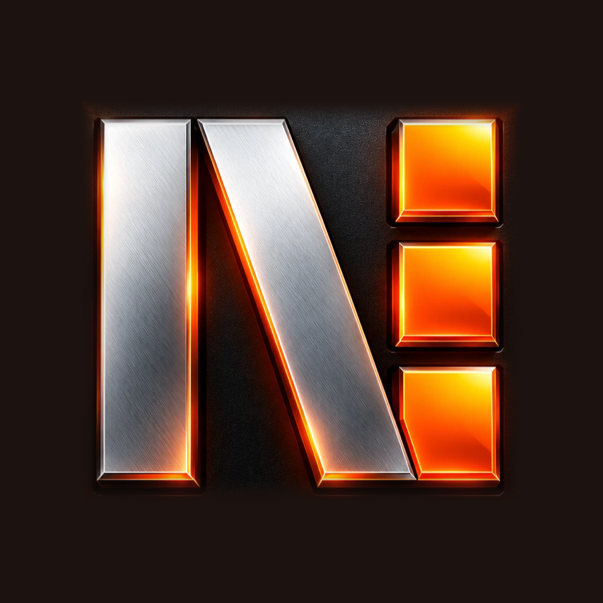
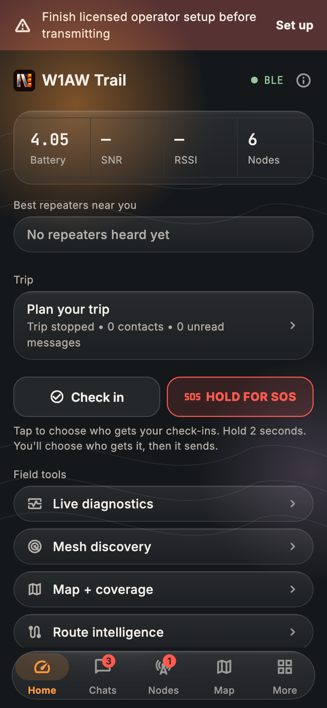
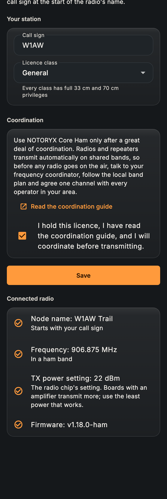
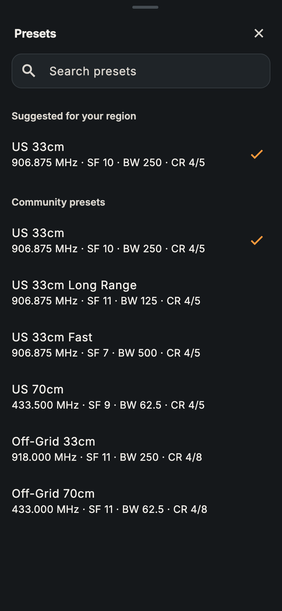
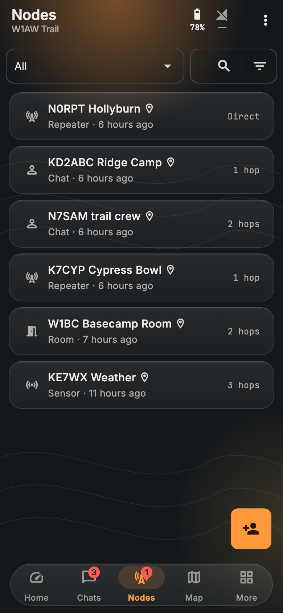
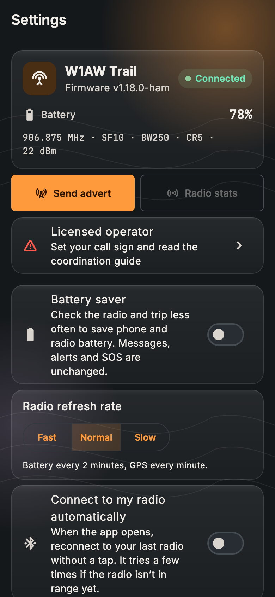

  

# NOTORYX Core Ham releases

Downloads for **NOTORYX Core Ham**: off-grid LoRa mesh messaging for licensed US amateur radio operators (FCC Part 97). It's the ham edition of NOTORYX Core and installs as its own app (`com.bastionmesh.ham`), next to NOTORYX Core.

> [!WARNING]
> **Use only after a great deal of coordination.** This software and its firmware transmit automatically on shared amateur bands, and every repeater relays under its operator's licence. Before any radio goes on the air, coordinate with your frequency coordinator, the local band plan and every operator in your area. Read the [coordination guide](COORDINATION.md) first.

  
  
  

## Status

**No builds are published yet.** The app and the [NOTORYX Ham firmware](https://github.com/TheLogsAreScreaming/NOTORYX-Core-Ham-Firmware) pass automated tests and a mesh simulator, and are now being tested on real radios. Releases will appear here once that's done.

## What it does

- **Your call sign on every frame**, including frames a repeater relays. A radio stays silent until its name starts with a valid US call sign.
- **Plain text, as Part 97 requires.** Authentication is kept; nothing is encrypted. Everything you send is readable by anyone.
- **33 cm and 70 cm only**, with US presets (906.875 MHz default).
- **Repeater logins without sending the password.**
- **Licensed operator setup** in the app: call sign, licence class and a coordination acknowledgment.
- Everything else from NOTORYX Core: check-ins, SOS, trip contacts, maps, path tools and field tools.

The ham firmware doesn't talk to ordinary MeshCore radios: every radio in your mesh, repeaters included, needs it.

## Supported radios

Heltec V4 · Heltec T114 · RAK WisBlock / WisMesh (RAK4631) · RAK WisMesh 1W Booster (RAK3401 + 13302) · Seeed Studio SenseCAP T1000-E · UnitEng Station G2 · UnitEng Station G3

  
  

## Data files

This repository also hosts the live files the app checks for updates:

- `regional_presets.json`: coordinated radio settings by area (empty for now; ham-band entries only)
- `channel_directory.json`: the public channel directory
- `COORDINATION.md`: what to coordinate before transmitting

Source: [NOTORYX-Core-Ham](https://github.com/TheLogsAreScreaming/NOTORYX-Core-Ham) (app) and [NOTORYX-Core-Ham-Firmware](https://github.com/TheLogsAreScreaming/NOTORYX-Core-Ham-Firmware) (firmware).
